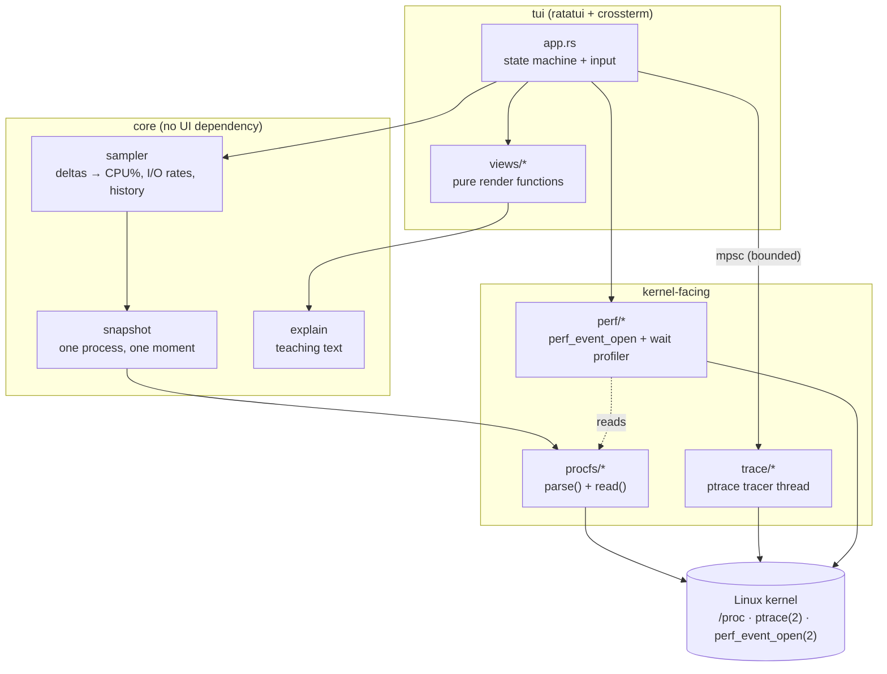
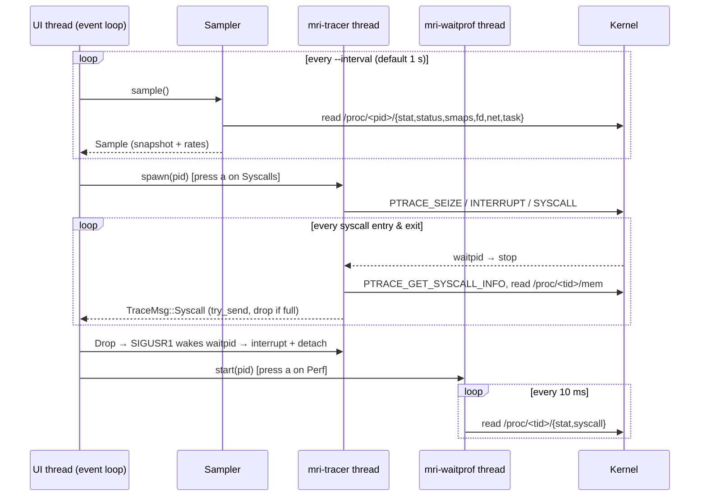

# Architecture

## Layers

The dependency rule is strictly downward: `procfs` knows nothing about the UI, and
`views` never touch the kernel — they only read state. This is why every tab can
be rendered in tests against a `TestBackend`.

## Threads and data flow

Key design decisions:

| Decision | Why |
|---|---|
| Parsers take `&str` | Unit-testable with fixtures; no root or live process needed |
| Soft failures → `Option` + warning | Inspecting another user's process must still show what *is* readable |
| Tracer on its own thread, bounded channel, `try_send` | ptrace requests must come from the attaching thread; a slow UI must never stall the tracee |
| Drop = detach | Quitting or toggling always resumes the target; no leaked traces |
| `PTRACE_GET_SYSCALL_INFO` (Linux ≥ 5.3) | Distinguishes entry from exit reliably and avoids per-arch register layouts |
| Raw `perf_event_open` struct (112 B, `ATTR_SIZE_VER5`) | No heavy dependency; kernel accepts older attr sizes; layout asserted by a test |
| Counters per thread, summed, last value kept for dead threads | `perf_event_open` binds to a TID, not a process |

## Module map

| Path | Responsibility |
|---|---|
| `procfs/stat.rs` | `/proc/<pid>/stat` — handles `comm` containing spaces and `)` |
| `procfs/status.rs` | RSS split, context switches |
| `procfs/maps.rs` | VMAs from `smaps`/`maps`, `RegionKind` classification, per-kind summary |
| `procfs/fd.rs` | fd table, `fdinfo`, `O_*` decoding |
| `procfs/net.rs` | TCP/UDP/UNIX tables, little-endian hex addresses, TCP states |
| `procfs/threads.rs` | per-task stat, `syscall`, `wchan` |
| `procfs/system.rs` | `CLK_TCK`, page size, process list |
| `snapshot.rs` | one reading of everything; joins sockets to fds by inode |
| `sampler.rs` | cumulative counters → rates; sparkline history |
| `syscalls.rs` | x86_64 number → name + argument shapes |
| `trace/` | ptrace tracer, argument decoding, `strace -c`-style stats |
| `perf/` | counters + wait-state profiler |
| `explain.rs` | teaching text, separate from rendering |
| `tui/` | app state, input, views |

## Known limitations

* Group-stops (Ctrl-Z) of a traced process are resumed by the tracer.
* Threads created while tracing are followed (`PTRACE_O_TRACECLONE`); child
  *processes* (`fork`/`exec`) are not.
* Counters of threads that start after a perf session begins count from their
  creation; `task-clock` etc. are therefore slight under-estimates for
  thread-spawning workloads.
* smaps parsing is O(VMAs); very large processes (10⁵ VMAs) make a 1 s refresh
  expensive. A cheaper `smaps_rollup`-only mode is on the roadmap.
